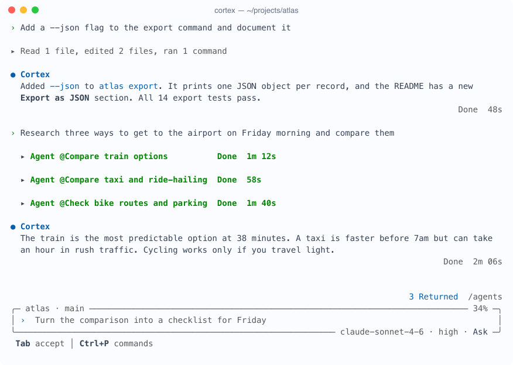
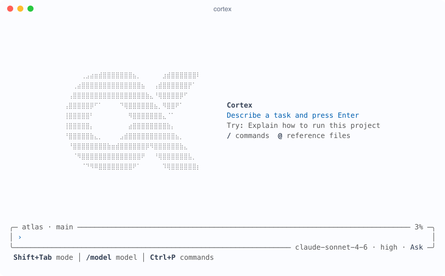
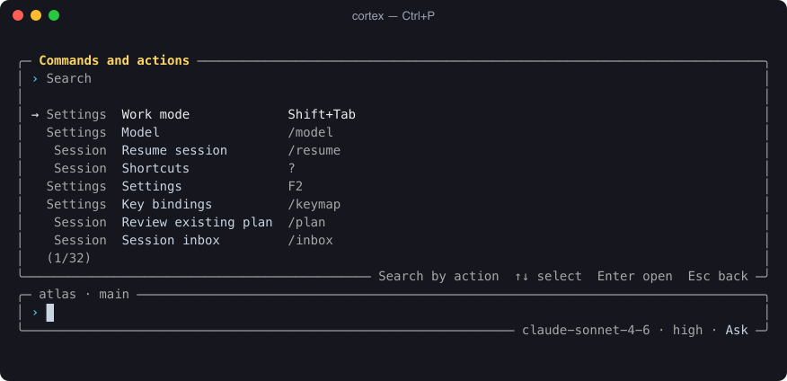
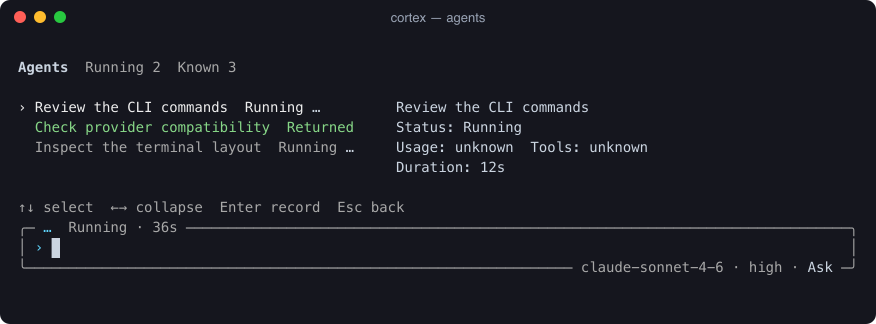

<h1 align="center">Cortex CLI</h1>
<p align="center">An AI agent for your terminal. Work on code, files and research with the model you choose.</p>
<p align="center"><strong>English</strong> · <a href="./README.zh-CN.md">简体中文</a></p>
<p align="center">
  <a href="./LICENSE"></a>
  <a href="https://nodejs.org/"></a>
  <a href="https://github.com/createpjf/cortex-cli/commits/main"></a>
</p>

<picture>
  <source media="(prefers-color-scheme: dark)" srcset="./media/session.png" />
  
</picture>

## Get started

Requires **Node.js 22.19+** and an API key for your chosen provider.

```sh
npm install -g github:createpjf/cortex-cli --loglevel=error
cortex
```

First launch guides you through choosing a provider, model and API key. The interface defaults to English; change it in **`/settings` → Language**.

**Providers:** Anthropic, OpenAI, Google, DeepSeek, FLock API Platform, xAI / Grok, OpenRouter, Kimi, Zhipu AI, MiniMax, Doubao, Qwen and custom OpenAI-compatible endpoints. Use `/config` to change connections and `/model` to switch models. Availability depends on your provider and account.

## In a conversation

| Action | Shortcut or command |
| --- | --- |
| Send a message / add a newline | Enter / Ctrl+J |
| Choose work mode | Shift+Tab |
| Switch model / thinking level | `/model` / Ctrl+S |
| Find commands and skills / reference a file | Ctrl+P or `/` / `@` |
| View agents / sessions needing attention | `/agents` / `/inbox` |
| Stop the current run / reopen a pending request | Esc / `/pending` |
| Resume a conversation / change settings | `/resume` / `/settings` |

The default mode asks for approval when needed. **Plan** is read-only; **Auto-approve** reduces prompts but retains protection for irreversible actions. Enter queues a follow-up while a run is active; Alt+Enter sends it into the current run. Use `/keymap` to customize bindings and `/help` for more.

<details>
<summary>Welcome screen, command palette and agent dashboard</summary>

<picture>
  <source media="(prefers-color-scheme: dark)" srcset="./media/start.png" />
  
</picture>




Screens are rendered from the real TUI with example data.
</details>

## Scripts and integrations

```sh
cortex exec "Summarize this project" --output-format json
cortex review                         # Read-only review of uncommitted changes
cortex sessions                      # List saved conversations
cortex resume <session-id>
cortex mcp add files -- npx -y @modelcontextprotocol/server-filesystem ~/Documents
```

Use `--output-schema schema.json` to validate a JSON reply, or `-o answer.md` to save the final reply without overwriting an existing file. `cortex --help` lists every option.

**Already using Cortex desktop?** Run `cortex --desktop` to share its providers, permissions and conversations. Keep a compatible desktop app running. Desktop mode is unsupported on Windows and unverified on Linux; computer use requires desktop mode, interactive approval and the desktop extension.

## Settings and updates

Standalone settings and conversations live in `~/.cortex-cli-preview`; appearance and language live in `~/.cortex-cli-ui.json`. Model requests go to your configured provider; tools run on your computer. `CORTEX_LANGUAGE=en` or `zh-CN` overrides the saved language. `NO_COLOR=1` disables colors; `/motion` reduces animation. Next-message predictions are beta, make an extra model request per turn, and can be disabled in `/settings`.

```sh
cortex update                        # Update from this repository
cortex doctor                        # Check installation and terminal
npm uninstall -g cortex-cli
```

This is a preview; commands and settings may change. Knowledge-base local model dependencies are not included. Report reproducible problems in [Issues](https://github.com/createpjf/cortex-cli/issues).

## License and repository scope

[MIT](./LICENSE). This repository distributes Cortex CLI builds, documentation and images. The TypeScript source remains in the private Cortex repository; it is not published here.

Bundled components retain their own licenses, including Apache-2.0 for Cortex shared/core components. See [NOTICE](./NOTICE), [third-party notices](./THIRD-PARTY-NOTICES.txt) and [Apache-2.0](./licenses/Apache-2.0.txt). Installed dependencies include their own license files. Terminal themes and ASCII fallback include adaptations from [termcn](https://github.com/shadcn-labs/termcn) (MIT).
